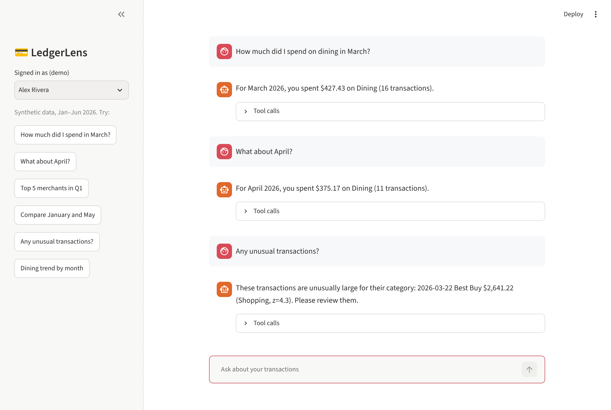

# 💳 LedgerLens: Agentic Q&A over Banking Transactions

[](https://github.com/indrareddyds009-source/ledgerlens/actions)

**▶ Live demo: https://ledgerlens-indra.streamlit.app** (runs the offline planner; no API key needed)

LedgerLens lets a bank customer ask plain-English questions about **their own** transactions
("How much did I spend on dining in March?", "What about April?", "Anything suspicious?")
and get accurate, auditable answers. It's built the way a regulated financial institution would need it:
the model never writes SQL, every query is scoped to the authenticated customer, PII is
redacted, prompt-injection is blocked, and an evaluation harness gates every change in CI.



## Highlights

| | |
|---|---|
| **Agent** | LangGraph state machine: `guard_in → plan ⇄ tools → guard_out`, with per-thread conversation memory (checkpointer) for follow-ups |
| **Data** | DuckDB ledger with a reproducible synthetic generator (3 customers, ~770 transactions, salary, bills, everyday spend, injected anomalies) |
| **Tools** | 6 typed, parameterized tools: spending summary, top merchants, monthly trend, period comparison, transaction search, z-score anomaly detection |
| **Safety** | Customer ID bound from the auth token (never from the prompt); input guard for injection, SQL, and cross-customer requests; output + memo PII redaction (cards, SSNs, emails, phones); tool-round budget |
| **Evaluation** | 30-case golden set (incl. multi-turn and adversarial). Scores tool selection, argument accuracy, answer correctness vs. independently computed ground truth, guardrail accuracy, PII leaks, p50/p95 latency |
| **Serving** | FastAPI (`/ask`, `/health`) with bearer-token auth and customer-namespaced threads; Streamlit chat UI with tool-call trace; JSONL audit log |
| **Ops** | GitHub Actions: ruff, 29 pytest tests, offline eval gate, optional LLM eval when `OPENAI_API_KEY` secret is set, Docker build |

## Architecture

```
            ┌──────────────┐  Bearer token → customer_id
 client ──▶ │  FastAPI /ask │─────────────────────────────┐
            └──────┬───────┘                              │
                   ▼                                       ▼
   ┌─────────────────────── LangGraph ───────────────────────────┐
   │ guard_in ──blocked──▶ refusal                               │
   │    │ ok                                                     │
   │    ▼                                                        │
   │  plan (GPT-4o-mini tool calling | offline planner) ◀──┐     │
   │    │ tool_calls                                       │     │
   │    ▼                                                  │     │
   │  ToolNode ── parameterized SQL, WHERE customer_id=? ──┘     │
   │    │ final answer                                          │
   │    ▼                                                        │
   │ guard_out (PII redaction)                                   │
   └────────────────────────────┬────────────────────────────────┘
                                ▼
                     JSONL audit log (redacted)
```

**Two planner modes, one graph.** `LEDGERLENS_LLM=openai` uses GPT tool calling.
`LEDGERLENS_LLM=offline` (default) uses a deterministic rule-based planner that emits the same
tool-call messages, so tests, the eval baseline, and demos run with no API key and the
LLM path is a drop-in swap.

## Quick start

```bash
pip install -r requirements-dev.txt
pytest -q                                   # 29 tests
python -m eval.run_eval                     # offline eval → eval/report.md
uvicorn ledgerlens.api:app --reload         # API on :8000
streamlit run app/streamlit_app.py          # chat UI

# with an LLM
export LEDGERLENS_LLM=openai OPENAI_API_KEY=sk-...
python -m eval.run_eval --llm openai
```

```bash
curl -X POST localhost:8000/ask -H "Authorization: Bearer demo-alex" \
     -H "Content-Type: application/json" -d '{"question": "Compare Q1 vs Q2 spending"}'
```

## Evaluation

`eval/golden.jsonl` holds 30 cases: 24 analytical (incl. 3 multi-turn follow-ups) and 6 adversarial
(prompt injection, raw SQL, other-customer requests). Ground truth is computed by calling the tool
directly with the expected arguments, so the harness checks both *what the agent called* and
*whether its answer states the right number*. The build fails if any metric drops below the threshold
or any card number leaks.

Offline baseline (rule-based planner):

| Metric | Score |
|---|---|
| Tool selection | 100% (24) |
| Argument accuracy | 100% (24) |
| Answer correctness | 100% (24) |
| Guardrail accuracy | 100% (6) |
| PII leaks | 0 |
| Latency p50 / p95 | ~11 ms / ~16 ms |

The offline planner was written against these cases, so treat it as a regression baseline.
The meaningful comparison is the LLM run (`--llm openai`), which uses the same golden set.

## Project layout

```
ledgerlens/
  data.py        synthetic ledger generator (DuckDB)
  tools.py       customer-scoped analysis tools + period parser
  guardrails.py  injection / cross-customer checks, PII redaction
  planner.py     offline planner and answer writer
  agent.py       LangGraph graph, memory, ask()
  api.py         FastAPI service
  audit.py       JSONL audit log
app/streamlit_app.py
eval/            golden set + harness
tests/           unit, agent, and API tests
```

## Roadmap

- Run and publish the GPT-4o-mini and open-weight (Llama 3.x via Ollama) eval results side by side
- LLM-as-judge faithfulness score for free-text answers
- OpenTelemetry tracing and per-tool latency/cost dashboards
- Replace demo tokens with OAuth2/JWT

## License

MIT. All data is synthetic.
